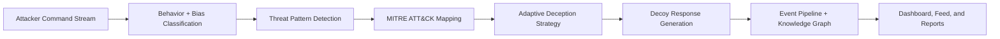

# Cognitive Deception

A full-stack, adaptive cyber-deception platform that simulates attacker behavior, classifies intent, maps activity to MITRE ATT&CK, and responds with dynamic decoy strategies.

[](https://github.com/Vinay-711/cognitive-deception/actions)
[](backend/requirements.txt)
[](backend/src/cognitive_deception/api/main.py)
[](frontend/package.json)
[](backend/src/cognitive_deception/models/entities.py)

## Platform Flow



## Why This Project Stands Out

- Real-time command analysis with attacker behavior profiling.
- Cognitive bias prediction used to adapt deception policy.
- Synthetic enterprise universe (users, files, credentials, chats, email bait).
- MITRE ATT&CK-aligned telemetry and report generation.
- Terminal-style simulation + API + frontend command center.
- Optional integrations: Kafka, Elasticsearch, Neo4j, Redis.

## Monorepo Structure

```text
cognitive-deception/
  backend/
    src/cognitive_deception/
    tests/
    requirements.txt
  frontend/
    app/
    components/
    services/
  infrastructure/
    docker/
    kubernetes/
  datasets/
  docs/
  scripts/
```

## Quick Start

### 1) Backend

```bash
cd backend
python3 -m venv .venv
source .venv/bin/activate
pip install -r requirements.txt
cp .env.example .env
PYTHONPATH=src uvicorn cognitive_deception.api.main:app --reload --port 8000
```

### 2) Frontend

```bash
cd frontend
npm install
npm run dev
```

### 3) Open

- Frontend: http://localhost:3000
- Backend: http://localhost:8000
- API Docs: http://localhost:8000/docs

## Demo Scenario

Run the end-to-end demo attack sequence and report generation:

```bash
./scripts/run_demo.sh
```

This executes a staged attacker progression (recon -> credential attempts -> exfiltration simulation) and produces structured telemetry.

## Core API Endpoints

- `POST /api/v1/sessions/start`
- `POST /api/v1/sessions/{session_id}/command`
- `GET /api/v1/sessions/{session_id}/events`
- `GET /api/v1/events/latest`
- `GET /api/v1/dashboard/metrics`
- `POST /api/v1/demo/run`
- `POST /api/v1/reports/generate`
- `GET /api/v1/reports`
- `GET /api/v1/network`
- `GET /api/v1/analysis`

## Infrastructure

- Docker Compose stack for local multi-service orchestration.
- Kubernetes manifests for backend/frontend/data services.
- GitHub Actions CI workflow in `.github/workflows/ci.yml`.

## Security and Privacy Posture

- No runtime secrets are committed.
- `.env` is ignored; only `.env.example` templates are versioned.
- Local DB, PID, and log artifacts are ignored.
- Attack command execution is simulated, not executed on host infrastructure.

## Documentation

- Architecture: `docs/ARCHITECTURE.md`
- API notes: `docs/api.md`
- Deployment: `docs/deployment.md`
- External resources: `docs/EXTERNAL_RESOURCES.md`

## Contributing

1. Fork the repository.
2. Create a feature branch.
3. Run backend tests:
   ```bash
   cd backend && .venv/bin/python -m pytest
   ```
4. Open a pull request with a clear summary and test evidence.

## Documentation and local evaluation

Start with [backend API entry point](backend/src/cognitive_deception/api/main.py), [frontend setup](frontend/README.md) and [architecture context](architecture/README.md). The [ai_engine](ai_engine/README.md) directory contains lightweight demonstration components; the backend package has its own AI implementation.

Run simulations only in an isolated environment you control. Synthetic attack streams and inferred behavior labels are not evidence about a real person’s motives. Optional Kafka, Redis, Elasticsearch, Neo4j and honeypot integrations need separate verification; a fallback demo does not establish that those services are connected.
